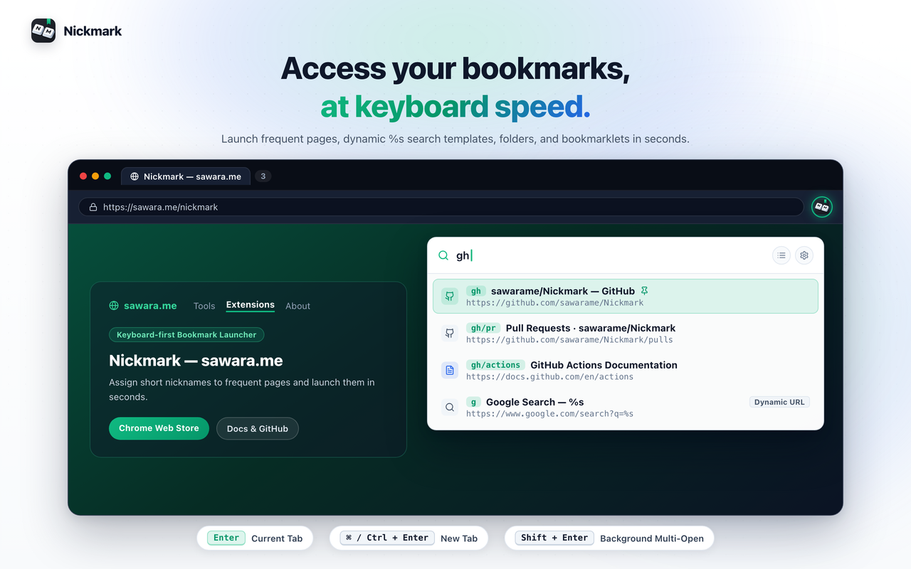
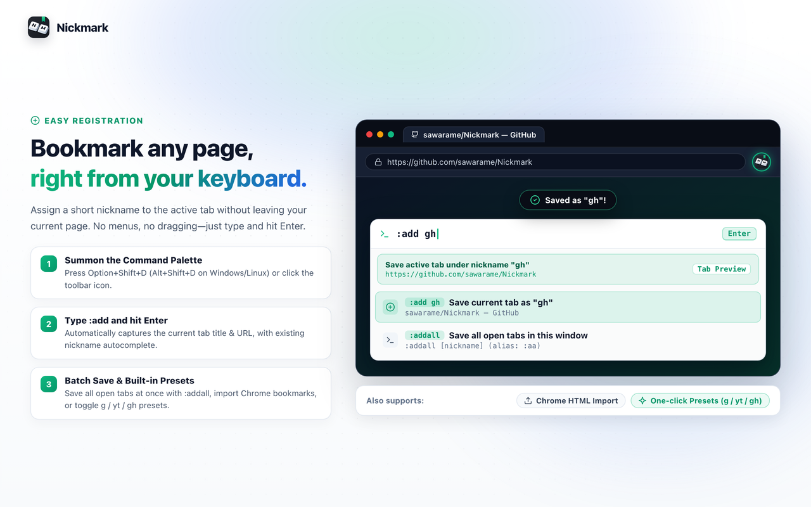
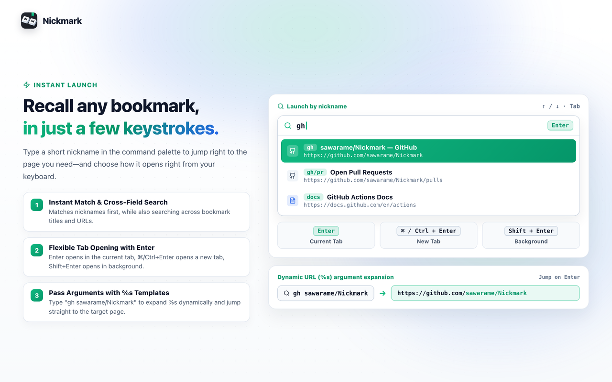
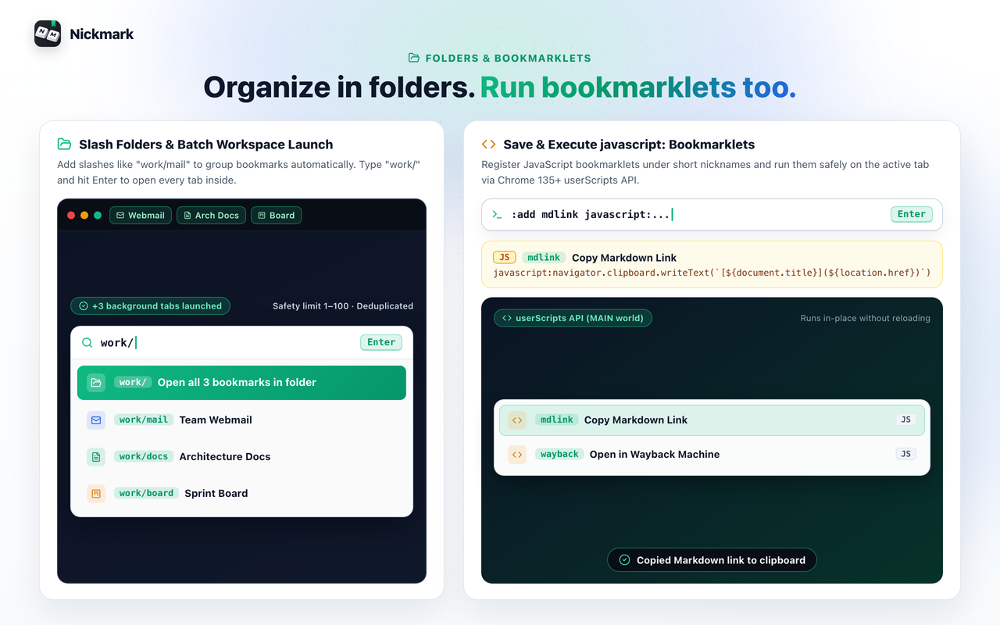
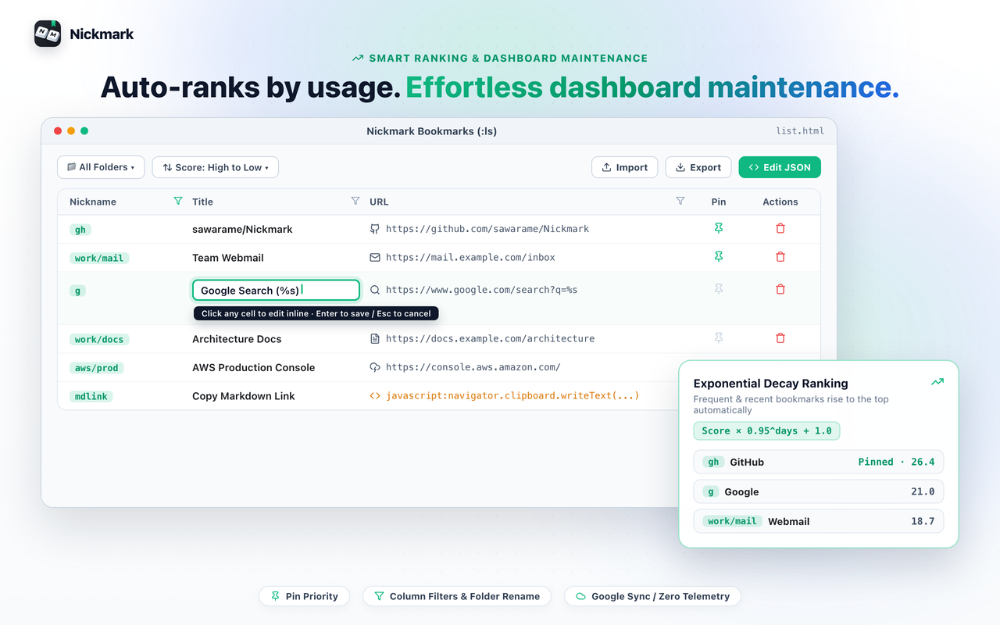

import ToolPageHeader from '@site/src/components/ToolPageHeader';
import ExtensionDownloadSection from '@site/src/components/ExtensionDownloadSection';
import NickmarkPng from '@site/src/icons/Nickmark.png';

<ToolPageHeader
  title="Nickmark"
  desc="A keyboard-optimized Chrome extension for instantly accessing bookmarks, dynamic URLs, and bookmarklets from a command palette popup using nicknames."
  icon={}
  color1="#3b82f6"
  color2="#1e3a8a"
/>

<ExtensionDownloadSection
  title="Get Nickmark"
  links={[
    { label: 'Chrome Web Store', href: 'https://chromewebstore.google.com/detail/nickmark/bicojpjoabhecikokcohbjgaiojggpno' },
    { label: 'Microsoft Edge', isComingSoon: true }
  ]}
/>

:::info Introduction & Interactive Demo
Try out the command palette directly in your browser on the [**Nickmark Overview & Interactive Demo (/nickmark)**](/nickmark).
:::

---

## Opening the Popup

In Nickmark (v2.1.0), all searching, registering, deleting, and navigation to management screens are unified into a **command palette popup**.

- **Keyboard Shortcut**: **`Option + Shift + D`** (macOS) / **`Alt + Shift + D`** (Windows / Linux)
  - You can customize this shortcut anytime at `chrome://extensions/shortcuts`.
- **Toolbar Icon**: Clicking the Nickmark icon in the browser toolbar also opens the exact same command palette.



:::note Contextual Tips When Empty
When the search input is empty, a helpful usage tip (TIP) is displayed below the input bar. Click the tip area to cycle to another tip while keeping keyboard focus in the search box.
:::

---

## Basic Usage

### 1. Registering a Bookmark (`:add` / `;add`)

1. Open the web page you want to bookmark.
2. Press **`Option + Shift + D`** (or **`Alt + Shift + D`**) to open the command palette.
3. Type **`:add dev`** (or alias **`:a dev`**) and press `Enter`.
   - You can also start commands with a **semicolon `;`** (e.g. `;add dev`), which is especially convenient on Japanese and some international keyboards.
4. A confirmation banner appears inside the popup, and the current tab is saved as `dev` without switching pages.



:::tip
- If the current page is already registered under another nickname, typing `:add` shows an informational banner in the popup listing the existing nickname(s).
- All registration, deletion, and error notifications are displayed cleanly inside the popup without forcing a tab switch, even on restricted pages such as `chrome://`.
:::

### 2. Opening a Bookmark (Search & Tab Actions)

1. Press **`Option + Shift + D`** (or **`Alt + Shift + D`**) to open the command palette.
2. Type **`dev`**—matching bookmarks are suggested in real time as you type.
3. Move through candidates (`↑` / `↓` or `Ctrl + N` / `Ctrl + P`) and open using your preferred key combination:
   - **`Enter`** (or click): Open in the current tab
   - **`Cmd / Ctrl / Alt + Enter`**: Open in a new foreground tab
   - **`Shift + Enter`**: Open in a background tab while keeping the palette open



:::info
Enable **"Open in a new tab by default"** in Preferences (`:prefs`) to make plain `Enter` open bookmarks in a new foreground tab. With the sub-option **"Open in the current tab when on a New Tab"**, opening from a New Tab page will still reuse that tab.
:::

### 3. Deleting a Bookmark (`:rm`)

1. Open the command palette and type **`:rm dev`** (or **`;rm dev`**).
2. Confirm the target candidate and press `Enter` to delete it.
   - If multiple URLs are registered under the same nickname, all entries are listed so you can select and remove a specific URL safely without accidental deletion.

---

## Regular Search Mode

Typing keywords directly into the command palette runs a search across your bookmarks (case-insensitive).

### Match Priority & Sorting

Matching results are sorted by the following priority (`Match Tier` > `Pinned` > `Score Descending` > `URL Ascending`):

1. **Exact nickname match**
2. **Prefix nickname match**
3. **Substring nickname match**
4. **Cross-field title & URL match** (supports space-separated AND filtering)

### Dynamic URLs (`%s` Placeholder)

Include **`%s`** in any URL to turn it into a dynamic shortcut that accepts arguments after the nickname:

- **Example**: `gh sawarame/Nickmark` → `https://github.com/sawarame/Nickmark`
- **Smart Encoding**: `%s` in the path segment (before `?` or `#`) preserves `/` while encoding each segment; `%s` in the query or hash segment is URL-encoded as a whole.
- **When Omitted**: If a `default_value` is configured, it is substituted for `%s`; otherwise Nickmark navigates to the site's origin (homepage).

### Folder Organization & Batch Open

Include slashes (`/`) in nicknames to organize bookmarks into hierarchical folders (e.g., `work/mail`, `work/docs`, `infra/aws/prod`).

- **Batch Open**: Type **`work/`** (ending with `/`) and press `Enter` to open all openable URLs under that folder in background tabs.
- **Nested Segment Matching**: You can match not only from the root path, but also intermediate folder segments at `/` boundaries—for example, typing **`repo/`** or **`repo`** matches `github/repo`, sorted alphabetically.
- **Deduplication & Safety Limit**: Duplicate URLs and `javascript:` bookmarklets are automatically skipped. If the tab count exceeds your configured safety limit (1–100 tabs, default `20`), a confirmation dialog is shown inside the popup.

### Bookmarklet Execution (`javascript:`)

Register `javascript:...` URLs to execute bookmarklets directly on the active tab without navigating away (powered by Chrome 135+ `userScripts` API in the `MAIN` world).



:::warning Enabling User Scripts (Chrome 135+)
To run `javascript:` bookmarklets, enable **"Allow User Scripts"** on Nickmark's extension details page (`chrome://extensions`). If disabled, Nickmark displays a notice in the popup and management dashboard.
:::

### Browser History Search (Opt-in)

When **"Include Browser History in Popup Search"** is enabled in Preferences (`:prefs`) and history permission is granted, matching browser history entries (up to 10 items) appear under a **Browser History** section below bookmark results.

- URLs already present in bookmark results are automatically deduplicated.
- Opening a history entry never modifies bookmark learning scores.
- Because the `history` permission is optional (`optional_permissions`), it is never requested unless you explicitly enable this feature.

### Exponential Decay Scoring & Pinning

Nickmark automatically learns which URLs you rely on most frequently and recently:

- **Formula**: `Score_new = (Score_old * 0.95 ^ elapsedDays) + 1.0`
- Frequently and recently used bookmarks rise to the top; unused ones gradually decay over time.
- Pinning (`is_pinned`) an entry in the dashboard keeps it prioritized within its match tier.

---

## Command Mode (`:` / `;` Prefix)

Start your input with a colon **`:`** or semicolon **`;`** to enter Command Mode. Inputs starting with `;` are normalized internally to `:` and autocompleted in standard `:command` format.

| Command | Alias | Description | Example |
| :--- | :--- | :--- | :--- |
| `:add [nickname] [url (opt)] [title (opt)]` | `:a` | Save the active tab, a custom `http(s)://` URL, or a `javascript:` bookmarklet. Suggests existing folder prefixes/nicknames and previews the target while typing. | `:add note Meeting Notes` / `:add mdlink javascript:...` |
| `:addall [nickname]` | `:aa` | Save all open tabs in the current window (excluding `chrome://` pages, etc.) under a nickname. | `:aa workspace` |
| `:rm [nickname] [url (opt)]` | — | Remove a nickname or a specific URL entry. | `:rm old-site` |
| `:ls` | — | Open the bookmark management dashboard in a new tab. | `:ls` |
| `:prefs` | — | Open Preferences. | `:prefs` |
| `:help` | — | Open this help & documentation page. | `:help` |

:::note Nickname Validation Rules
To prevent conflicts with command syntax and dynamic URLs, nicknames cannot contain **whitespace, `:`, `;`, `\`, `%`, `?`, `#`, `&`, `=`, `*`, `"`, `'`, `` ` ``, `<`, `>`, `|`, control characters, or zero-width characters**. Forward slash **`/`** is allowed for folder hierarchy.
:::

---

## Management Dashboard (`:ls`)

Run **`:ls`** in the palette or click the list icon in the palette header to open the management dashboard (`list.html`).



- **Inline Cell Editing**: Click any nickname, title, or URL cell to edit inline (`Enter` or blur saves, `Esc` cancels). For dynamic URLs (`%s`), `default_value` can be edited in the same cell.
- **Per-Column Filtering**: Click the filter button on the Nickname, Title, or URL column headers to filter in real time with space-separated AND matching.
- **Flexible Sorting**: Sort via the toolbar dropdown (**Default**, **Last Used (Newest/Oldest)**, **Score (Highest/Lowest)**) or click column headers.
- **Folder Actions**: Selecting a folder from the filter bar reveals **Open All**, **Rename Folder**, and **Delete Folder** actions.
- **Import / Export / JSON Editor**:
  - **Import**: Import from Nickmark JSON or Chrome Bookmarks HTML with a pre-import preview, optional destination folder, and Merge/Overwrite mode selection.
  - **Edit in JSON**: Bulk-edit all bookmarks in the built-in JSON editor.
  - **Export**: Download a full JSON backup anytime.

---

## Preferences (`:prefs`)

Run **`:prefs`** in the palette or click the gear icon in the palette or dashboard header to open Preferences (`preferences.html`).

- **Google Account Sync**: Switch between unlimited local storage (`chrome.storage.local`) and Chrome account synchronization (`chrome.storage.sync`, 100KB limit with automatic 8KB chunking). Switching modes opens a migration dialog comparing local vs. cloud item counts and timestamps.
- **Language**: Switch instantaneously between `English` and `日本語` without reloading.
- **Safety Limit for Batch Open Tabs**: Configure the maximum number of tabs opened without confirmation (1–100, default `20`).
- **Open in New Tab**:
  - **Open in a new tab by default**: Opens items in a new foreground tab even without modifier keys.
  - **Open in the current tab when on a New Tab**: Sub-option that reuses the active tab when you launch from a New Tab page.
- **Browser History Search**: Opt-in toggle to show matching browser history below bookmark suggestions.
- **Built-in Presets (18 Total)**: Enable popular search shortcuts and utility bookmarklets with checkboxes—only enabled IDs are stored, consuming virtually zero storage space.
  - **Search Services (15)**: `g` (Google), `b` (Bing), `y` (Yahoo! — locale-aware), `nv` (Naver), `bd` (Baidu), `ddg` (DuckDuckGo), `yt` (YouTube), `gh` (GitHub), `map` (Google Maps), `tr` (Google Translate), `wiki` (Wikipedia — locale-aware), `amz` (Amazon), `x` (X / Twitter), `npm` (npm), `mdn` (MDN Web Docs)
  - **Bookmarklets (3)**: `mdlink` (Copy Markdown link `[Title](URL)`), `htmllink` (Copy HTML link `<a href="URL">Title</a>` as `text/html` + `text/plain` for Teams, etc.), `wayback` (Open in Wayback Machine)

---

## 📥 JSON Specification

The dashboard's JSON editor, export, and import features use the following JSON schema:

### Field Descriptions

- **`bookmarks`**: The root object.
  - **`{nickname}`**: Each key inside `bookmarks` is a nickname (slashes `/` represent folders). Its value is an array of bookmark objects.
    - **`url`**: Destination URL or `javascript:` bookmarklet code (required).
    - **`title`**: Bookmark title.
    - **`score`**: Exponential decay usage score. Higher scores rank higher in suggestions.
    - **`last_used_at`**: Timestamp (milliseconds) of the last access.
    - **`created_at`**: Timestamp (milliseconds) of creation.
    - **`is_pinned`** (optional / boolean): When `true`, pins the entry to the top of its match tier.
    - **`default_value`** (optional / string): Default value substituted for `%s` when opening a dynamic URL without arguments.

### Example

```json
{
  "bookmarks": {
    "gh": [
      {
        "url": "https://github.com/%s",
        "title": "GitHub Repository / User",
        "score": 24.5,
        "last_used_at": 1715731200000,
        "created_at": 1715731200000,
        "is_pinned": true,
        "default_value": "sawarame/Nickmark"
      }
    ],
    "work/mail": [
      {
        "url": "https://mail.example.com",
        "title": "Team Webmail",
        "score": 10.0,
        "last_used_at": 1715731300000,
        "created_at": 1715731100000
      }
    ]
  }
}
```
